<!--
  Widya Yasa — profile README
  Portfolio: https://widya-yasa.vercel.app
  Regenerate cards: python3 scripts/build.py
  Regenerate Pac-Man graph: scripts/generate-pacman.ps1
-->

<a href="https://widya-yasa.vercel.app">
<picture>
  <source media="(prefers-color-scheme: dark)" srcset="./assets/header-dark.svg?v=1" />
  <source media="(prefers-color-scheme: light)" srcset="./assets/header-light.svg?v=1" />
  
</picture>
</a>

<picture>
  <source media="(prefers-color-scheme: dark)" srcset="./assets/marquee-dark.svg?v=1" />
  <source media="(prefers-color-scheme: light)" srcset="./assets/marquee-light.svg?v=1" />
  
</picture>

  <a href="https://widya-yasa.vercel.app">Portfolio</a>
  &nbsp;·&nbsp;
  <a href="https://github.com/widyasa">GitHub</a>
  &nbsp;·&nbsp;
  <a href="https://linkedin.com/in/widya-yasa">LinkedIn</a>
  &nbsp;·&nbsp;
  <a href="https://instagram.com/widya_yasaa">Instagram</a>

<picture>
  <source media="(prefers-color-scheme: dark)" srcset="./assets/section-profile-dark.svg?v=1" />
  <source media="(prefers-color-scheme: light)" srcset="./assets/section-profile-light.svg?v=1" />
  
</picture>

I build web apps and game experiences that feel **fast**, **intentional**, and **easy to use**.  
Currently taking freelance projects and open to full-time opportunities.

I'm someone who genuinely enjoys learning new things and sharing them with others — casual chats, sharing sessions, mentoring. I stay active in tech communities because the best way to grow is to be around people who are just as excited to learn.

<picture>
  <source media="(prefers-color-scheme: dark)" srcset="./assets/section-stages-dark.svg?v=1" />
  <source media="(prefers-color-scheme: light)" srcset="./assets/section-stages-light.svg?v=1" />
  
</picture>

<a href="https://widya-yasa.vercel.app">
<picture>
  <source media="(prefers-color-scheme: dark)" srcset="./assets/project-velnara-dark.svg?v=1" />
  <source media="(prefers-color-scheme: light)" srcset="./assets/project-velnara-light.svg?v=1" />
  
</picture>
</a>

<a href="https://widya-yasa.vercel.app">
<picture>
  <source media="(prefers-color-scheme: dark)" srcset="./assets/project-akumampu-dark.svg?v=1" />
  <source media="(prefers-color-scheme: light)" srcset="./assets/project-akumampu-light.svg?v=1" />
  
</picture>
</a>

<a href="https://widya-yasa.vercel.app">
<picture>
  <source media="(prefers-color-scheme: dark)" srcset="./assets/project-midnight-dark.svg?v=1" />
  <source media="(prefers-color-scheme: light)" srcset="./assets/project-midnight-light.svg?v=1" />
  
</picture>
</a>

→ more builds on the <a href="https://widya-yasa.vercel.app">portfolio</a>

<picture>
  <source media="(prefers-color-scheme: dark)" srcset="./assets/section-inventory-dark.svg?v=1" />
  <source media="(prefers-color-scheme: light)" srcset="./assets/section-inventory-light.svg?v=1" />
  
</picture>

<picture>
  <source media="(prefers-color-scheme: dark)" srcset="./assets/inventory-dark.svg?v=1" />
  <source media="(prefers-color-scheme: light)" srcset="./assets/inventory-light.svg?v=1" />
  
</picture>

<picture>
  <source media="(prefers-color-scheme: dark)" srcset="./assets/section-contrib-dark.svg?v=1" />
  <source media="(prefers-color-scheme: light)" srcset="./assets/section-contrib-light.svg?v=1" />
  
</picture>

<!-- Pac-Man eats the contribution grid — regenerate: scripts/generate-pacman.ps1 -->
<picture>
  <source media="(prefers-color-scheme: dark)" srcset="./assets/pacman-contribution-graph-dark.svg" />
  <source media="(prefers-color-scheme: light)" srcset="./assets/pacman-contribution-graph.svg" />
  
</picture>

<picture>
  <source media="(prefers-color-scheme: dark)" srcset="./assets/section-quests-dark.svg?v=1" />
  <source media="(prefers-color-scheme: light)" srcset="./assets/section-quests-light.svg?v=1" />
  
</picture>

<picture>
  <source media="(prefers-color-scheme: dark)" srcset="./assets/sidequests-dark.svg?v=1" />
  <source media="(prefers-color-scheme: light)" srcset="./assets/sidequests-light.svg?v=1" />
  
</picture>

<a href="https://widya-yasa.vercel.app">
<picture>
  <source media="(prefers-color-scheme: dark)" srcset="./assets/footer-dark.svg?v=1" />
  <source media="(prefers-color-scheme: light)" srcset="./assets/footer-light.svg?v=1" />
  
</picture>
</a>

  <a href="https://widya-yasa.vercel.app">Portfolio</a>
  &nbsp;·&nbsp;
  <a href="https://github.com/widyasa">GitHub</a>
  &nbsp;·&nbsp;
  <a href="https://linkedin.com/in/widya-yasa">LinkedIn</a>
  &nbsp;·&nbsp;
  <a href="https://instagram.com/widya_yasaa">Instagram</a>

